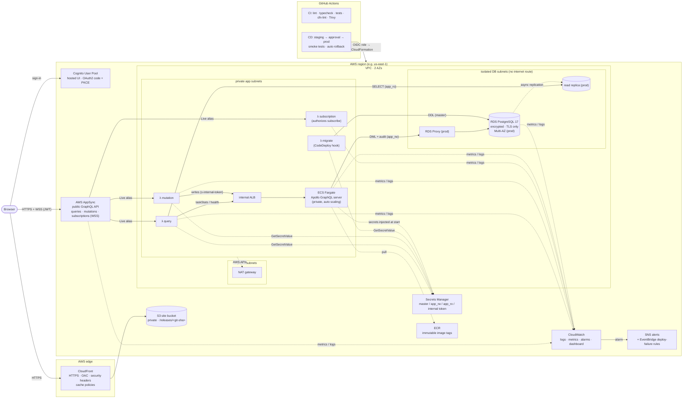

# Architecture

## System overview



When the read replica and RDS Proxy are disabled (staging), `app_ro` reads go to the
primary and both paths connect directly to the instance.

## Components

| Layer | Service | Why |
|---|---|---|
| Frontend | React 19 + Vite SPA in a **private S3 bucket** behind **CloudFront** (Origin Access Control) | Cheapest way to serve a static app globally with TLS, caching, security headers and no servers. `PriceClass_100`, no WAF by default (opt-in parameter). |
| Identity | **Cognito User Pool** (hosted UI, code + PKCE, optional TOTP MFA) | Managed users; AppSync verifies the JWTs natively. No client secret in the browser. |
| Public API | **AWS AppSync** | Fully managed GraphQL, including **subscriptions over WebSockets** (fan-out of mutation results), Cognito and IAM auth, a query-depth limit, and introspection off in prod. |
| Resolvers | **4 TypeScript Lambda functions** (Node 22, arm64) managed by the **Serverless Framework** | `query`, `mutation`, `subscription` (authorizes subscriptions), `migrate` (DB migrations as a CodeDeploy hook). Deployed with **CodeDeploy traffic shifting** on a `Live` alias. |
| Private GraphQL | **Apollo Server on ECS Fargate** in private subnets behind an **internal ALB** | Owns the write path (transaction + audit trail) and aggregations. Not reachable from the internet: only the Lambda security group can reach the ALB, and every request must carry the internal token. |
| Database | **RDS PostgreSQL 17** in isolated subnets | Encrypted and TLS-only; the master password is managed and rotated by Secrets Manager; least-privilege DB roles; optional RDS Proxy and read replica. |
| Secrets | **Secrets Manager** | All credentials are generated inside AWS. Workloads read them at runtime with narrowly scoped IAM. |
| Observability | **CloudWatch** Logs (JSON), Metrics, Alarms, Dashboard, Container Insights, X-Ray | See [monitoring-and-rollback.md](monitoring-and-rollback.md). |
| Delivery | **GitHub Actions** + CloudFormation + Serverless Framework | See [cicd.md](cicd.md). |

### Why both AppSync/Lambda *and* a Fargate GraphQL server?

The brief asks for both, so each gets a distinct job:

* **AppSync + Lambda** is the *public edge*. It handles authentication,
  authorization (the owner always comes from the verified JWT), input validation,
  real-time fan-out, and the cheap, high-volume **read path** (Lambda → read replica).
* **Fargate GraphQL** is a *private domain service*. It is the **single writer** to
  the database (transactions, audit log, invariants) and computes the aggregations.
  Its long-lived processes keep warm connection pools, which suits the write path.

## Request flows

### Query (`tasks`)

1. The browser sends its Cognito access token to AppSync.
2. AppSync validates the JWT and invokes the `query` Lambda (`Live` alias) through
   the shared APPSYNC_JS resolver.
3. The Lambda sets `owner = identity.sub` and validates the arguments with zod. It
   then runs an owner-scoped, parameterised `SELECT` with keyset pagination, as
   `app_ro`, on the read endpoint.

### Mutation + subscription (`createTask` → `onTaskChanged`)

```mermaid
sequenceDiagram
  autonumber
  participant B as Browser (tab A)
  participant B2 as Browser (tab B)
  participant AS as AppSync
  participant LS as λ subscription
  participant LM as λ mutation
  participant ALB as internal ALB
  participant GQL as Fargate GraphQL
  participant DB as RDS (primary)

  B2->>AS: subscribe onTaskChanged(owner: sub) over WSS
  AS->>LS: authorize subscription
  LS-->>AS: ok (owner == caller's sub) / error otherwise
  B->>AS: mutation createTask(input)  [JWT]
  AS->>LM: invoke (identity, args)
  LM->>LM: validate input, owner = identity.sub
  LM->>ALB: POST /graphql + x-internal-token
  ALB->>GQL: forward
  GQL->>DB: BEGIN; INSERT task; INSERT audit; COMMIT (app_rw)
  GQL-->>LM: Task
  LM-->>AS: { data: TaskChange }
  AS-->>B: TaskChange
  AS-->>B2: TaskChange (pushed: owner matches the subscription argument)
```

The Lambdas return expected failures (validation, not found, unauthorized) as
`{ error }`, and the resolver code turns them into GraphQL errors. These do **not**
count as Lambda `Errors`. The error alarms therefore fire only on real faults,
which matters because they also drive the automatic canary rollback.

## Scaling strategy

| Component | Mechanism | Staging | Production |
|---|---|---|---|
| CloudFront / S3 / AppSync / Cognito | Fully managed, scale automatically | — | — |
| Lambda | On-demand concurrency, capped by **reserved concurrency** (protects RDS) | 25 per function | 200 per function |
| Lambda (hot read path) | **Provisioned concurrency** on the `Live` alias, **Application Auto Scaling** target tracking at 70 % utilization | off | 2 – 20 |
| ECS Fargate | **Target tracking**: avg CPU 60 % **and** 500 requests/target (ALB); scale-out cooldown 60 s, scale-in 180 s | 1 – 3 tasks, Fargate **Spot** | 2 – 10 tasks, on-demand |
| RDS storage | **Storage autoscaling** up to `MaxAllocatedStorage` | 20 → 100 GiB | 20 → 100 GiB |
| RDS reads | **Read replica** serves `app_ro` traffic from the query Lambda | off | 1 replica |
| RDS connections | **RDS Proxy** pools and multiplexes Lambda + ECS connections | off | on |
| RDS compute | Vertical scaling (change `DB_INSTANCE_CLASS`, applied in the maintenance window); Multi-AZ for HA | db.t4g.micro | db.t4g.medium, Multi-AZ |

**Connection budget.** Each Lambda container holds at most one connection
(`max: 1`), and each Fargate task holds a pool of 10. The worst case in staging is
25 (query Lambda) + 3 × 10 (ECS) = 55 connections. That is below the
60-connection alarm and the roughly 80–110 `max_connections` of a `db.t4g.micro`.
In production, RDS Proxy multiplexes writer connections and the replica absorbs
read connections.

**Read-replica auto scaling.** RDS for PostgreSQL has no automatic scaling of the
replica *count*; that is an Aurora feature (`rds:cluster:ReadReplicaCount`). This
design uses a fixed replica count, and treats the `ReplicaLag`, CPU and connection
alarms as the signal to add replicas or move to a larger instance class. If
automatic replica scaling becomes a hard requirement, replace `database.yml` with
Aurora PostgreSQL Serverless v2. The application needs no changes, because it only
sees a write endpoint and a read endpoint.

## Cost profile (staging, rough us-east-1 list prices)

| Item | ≈ USD / month |
|---|---|
| NAT gateway (1) + its public IPv4 | 36 |
| Internal ALB | 17 |
| RDS db.t4g.micro + 20 GiB gp3 | 14 |
| Fargate Spot, 1 × 0.25 vCPU / 0.5 GB | 3 |
| Secrets Manager (4 secrets) | 2 |
| CloudWatch alarms (~30), logs, Container Insights | 5 – 10 |
| CloudFront, S3, AppSync, Lambda, Cognito at low traffic | ~0 – 5 (mostly free tier) |
| **Total** | **≈ 75 – 85** |

Production adds a second NAT gateway, Multi-AZ, a replica, RDS Proxy and on-demand
Fargate. Use the AWS Pricing Calculator for real numbers. NAT and the ALB are the
largest fixed costs. Replacing NAT with interface VPC endpoints only pays off at
higher data volumes.
