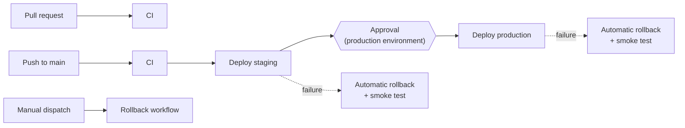

# CI/CD pipeline (GitHub Actions)

| Workflow | Trigger | Purpose |
|---|---|---|
| [`ci.yml`](../.github/workflows/ci.yml) | pull requests; called by `deploy.yml` | Build, test and validate. Needs no AWS access. |
| [`deploy.yml`](../.github/workflows/deploy.yml) | push to `main`, manual | CI, then staging, then approval, then production. One run at a time; never cancelled mid-way. |
| [`deploy-stage.yml`](../.github/workflows/deploy-stage.yml) | called by `deploy.yml` | Deploy, verify and auto-rollback one stage |
| [`rollback.yml`](../.github/workflows/rollback.yml) | manual | List versions, or roll one component back to a chosen version |

## CI (`ci.yml`): three parallel jobs

1. **Lint, typecheck, test, build**
   * `npm ci`, ESLint, `tsc` for every workspace.
   * Unit tests, plus **integration tests against a real PostgreSQL 17 service
     container**: migrations, role provisioning, least privilege, pagination.
   * `vite build` of the frontend, uploaded as the `frontend-dist` artifact. This
     **exact build** is later deployed to staging and production; per-stage settings
     come from `config.json` at deploy time.
2. **Validate infrastructure as code**
   * `cfn-lint` on every template.
   * `scripts/validate-serverless.mjs`: an offline `serverless package` for `staging`
     and `prod` (esbuild bundling plus the canary plugin), then `cfn-lint` on the
     generated CloudFormation.
   * `shellcheck` on the deployment scripts.
3. **Build & scan container image**: a Docker Buildx build with a GitHub Actions
   cache, then a **Trivy** scan that fails on fixable HIGH/CRITICAL vulnerabilities.

## Deploy (`deploy-stage.yml`): one job per stage

The job runs in the GitHub **environment** (`staging` or `production`). That gives:
* the environment's variables
* its protection rules (approval for production)
* an OIDC token whose `sub` claim (`…:environment:production`) is what the AWS role trusts

| # | Step | Notes |
|---|---|---|
| 1 | Checkout, `npm ci`, download `frontend-dist` | |
| 2 | **Configure AWS credentials** | `aws-actions/configure-aws-credentials` with OIDC: a one-hour session, no stored keys |
| 3 | **Record rollback points** | Current API deployment timestamp, ECS image URI and frontend release id |
| 4 | **DB snapshot** (prod only) | Manual snapshot before any migration can run |
| 5 | **Foundation** | `alerts`, `network` and `database` stacks via `aws cloudformation deploy --role-arn <cfn-execution-role>` |
| 6 | **Build & push image** | Tagged with the git SHA (immutable). If the tag already exists (built for staging), it is **promoted unchanged**. |
| 7 | **ECS stack** | CloudFormation waits for a steady state. The circuit breaker and the 5xx alarm roll back a bad image and fail the step. |
| 8 | **Frontend infrastructure** | Bucket, OAC, CloudFront, headers policy |
| 9 | **API** | `serverless deploy` packages with esbuild. CodeDeploy then runs the **migrate pre-traffic hook** and shifts the `Live` alias (all at once in staging; `Canary10Percent5Minutes` in prod, watched by the error alarms). |
| 10 | **Migrations** | Invokes the migrate Lambda. A no-op on updates; on the first deploy it creates the schema. |
| 11 | **Release frontend** | Uploads to `releases/<sha>/` with long-cache assets and `no-cache` entry points, switches the CloudFront origin path, and invalidates the cache |
| 12 | **Dashboard** | `monitoring` stack |
| 13 | **Smoke tests** | Must pass, and must see the new git SHA in both the API and the site |
| 14 | **Automatic rollback** (on failure) | See [monitoring-and-rollback.md](monitoring-and-rollback.md#rollback-strategy) |

### Configuration and secrets in CI

* **GitHub Environment variables** (not secrets) hold `AWS_REGION`,
  `AWS_DEPLOY_ROLE_ARN`, `ALERT_EMAIL` and the optional domain settings.
* **No GitHub secrets are needed at all.** AWS access is OIDC, and every runtime
  secret is generated and stored in Secrets Manager. The pipeline handles only
  *references* (ARNs) to secrets, passed between stacks as CloudFormation outputs,
  never secret *values*.
* If a third-party key is added later (for example a payment API), store it in
  Secrets Manager. Grant the consuming function `GetSecretValue` on that ARN and
  pass the ARN as an environment variable, the same way as the existing secrets. Do
  not put it in GitHub.

## Recommended repository settings

* Branch protection on `main`: require PRs, require the three CI checks, and require
  linear history.
* `production` environment: required reviewers, and deployment branches limited to `main`.
* Dependabot for npm, the Docker base image and GitHub Actions. Pinning actions to
  commit SHAs is recommended for supply-chain safety.
